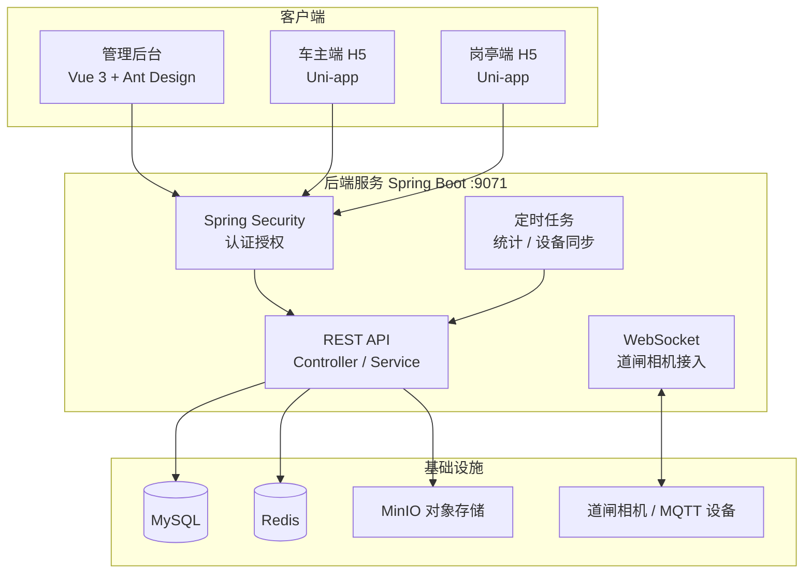
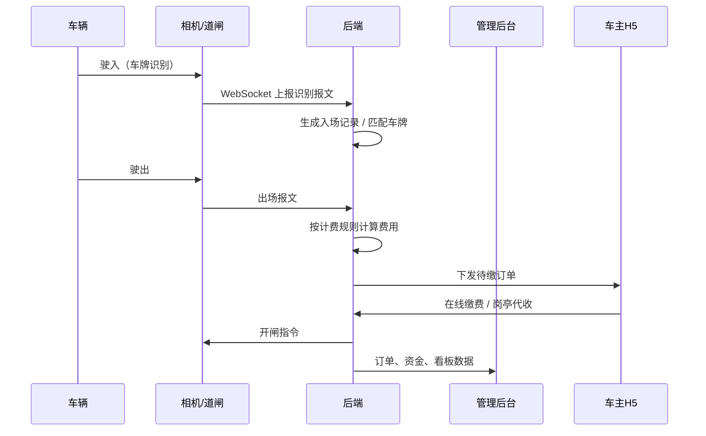

# 停车场管理系统（Parking Management System）

> 一套前后端分离的开源停车场运营管理平台，覆盖 **管理后台 + 车主端 H5 + 车场岗亭端 H5** 三端，
> 提供车场配置、车牌识别、道闸对接、计费收费、资金对账、线上开票、权限管理等一站式能力。

[](LICENSE)
[](https://www.oracle.com/java/)
[](https://spring.io/projects/spring-boot)
[](https://vuejs.org/)
[](https://uniapp.dcloud.net.cn/)
[](https://www.mysql.com/)

---

## 目录

- [系统简介](#系统简介)
- [功能特性](#功能特性)
- [外部系统集成](#外部系统集成)
- [技术栈](#技术栈)
- [系统架构](#系统架构)
- [项目结构](#项目结构)
- [快速开始](#快速开始)
  - [环境要求](#环境要求)
  - [1. 初始化数据库](#1-初始化数据库)
  - [2. 启动后端服务](#2-启动后端服务)
  - [3. 启动管理后台](#3-启动管理后台)
  - [4. 启动 H5 端](#4-启动-h5-端)
- [配置说明](#配置说明)
- [默认账号](#默认账号)
- [核心业务流程](#核心业务流程)
- [路线图](#路线图)
- [商业使用与联系方式](#商业使用与联系方式)
- [参与贡献](#参与贡献)
- [许可证](#许可证)

---

## 系统简介

本项目是一个面向停车场运营场景的全栈开源系统，由四个子工程组成：

| 子工程 | 说明 | 技术栈 |
| --- | --- | --- |
| `java_project/java-engineering` | 后端服务（REST API + WebSocket + 定时任务） | Spring Boot 2.2、Spring Security、Druid、Redis |
| `vue_project/vue-engineering` | 运营管理后台（PC Web） | Vue 3、Vite、Ant Design Vue、ECharts |
| `h5_project/parking_owner_h5` | 车主端 H5（找车位、缴费、发票、长租） | Uni-app（Vue 2）、uView |
| `h5_project/parking_lot_h5` | 车场岗亭端 H5（收费、巡查、车牌纠正） | Uni-app（Vue 2） |
| `h5_project/parking_h5` | 移动端（扫码入场、扫码缴费） | Uni-app（Vue 2） |

**适用场景**：商业停车场、路侧停车、园区车场、共享车位等需要「设备接入 + 计费收费 + 运营管理」的场景。

---

## 功能特性

### 运营管理后台（PC）

- **数据看板**：运营看板、车场看板 —— 实时展示剩余泊位、出入场车次、应收/实收金额、收缴率、单泊位收益等指标
- **车场管理**：车场配置、车场巡检、黑白名单、设备监控（道闸相机）
- **订单与计费**：停车订单、计费管理（阶梯计费 / 免费时段 / 封顶金额 / 多时段规则）、车辆欠费、异常数据
- **资金与票务**：资金管理、线上开票（电子发票申请与开具）
- **系统管理**：用户管理、角色管理（RBAC）、菜单管理、组织机构管理、数据字典、权限拦截
- **登录安全**：Spring Security 认证、BCrypt 密码加密、验证码、会话控制

### 车主端 H5

- 找车位、找长租、优惠券、扫一扫
- 停车记录与计费明细查询、在线缴费
- 我的车辆（绑定 / 车牌认证）、历史欠费一键清缴
- 长租购买与记录、钱包充值
- 电子发票（开票申请、发票列表）

### 车场岗亭端 H5

- 岗亭收费、停车记录查询
- 车牌识别纠错、车场巡检
- 钱包 / 账户管理、消息与建议反馈

### 后端服务

- **设备接入**：WebSocket 对接道闸相机（上报报文解析、车牌匹配、道闸控制）、MQTT 消息
- **识别与计费**：车牌识别记录、计费规则引擎（免费时长、阶梯费率、封顶价）
- **支付**：在线支付与支付回调（`PaymentNotify`）、支付查询、招商银行支付工具类
- **任务调度**：定时任务（日统计、道闸设备数据同步、萤石云摄像头同步等）
- **存储**：MinIO 对象存储（车牌图片等）、文件上传
- **权限**：接口级权限拦截、多角色菜单动态下发

---

## 外部系统集成

系统与以下外部平台 / 设备对接（标注为「已接入」的均有完整调用链路）：

### 支付渠道

| 外部系统 | 能力 | 对接代码 | 状态 |
| --- | --- | --- | --- |
| 招商银行聚合支付（CMB Polypay） | 微信支付 JSAPI 下单（`onlinepay`）、支付宝 Native 扫码（`zfbqrcode`）、聚合支付回调（`aggregateNotify`）、订单查询（`orderquery`）、退款接口（已封装） | `CMBPayUrlConsant`、`ScanYardCodeService`、`PaymentNotifyController`、`PayQueryService` | 已接入 |
| 银联云闪付 | `cloudpay` 接口地址预留 | `CMBPayUrlConsant`（仅注释） | 未启用 |
| 微信小程序支付 | `MiniAppOrderApply` 接口地址预留 | `CMBPayUrlConsant`（仅注释） | 未启用 |
| 派安盈（4pyun） | 历史残留代码 | `PYunService` | 未启用 |

### 车牌识别与道闸设备

| 外部系统 | 能力 | 对接代码 | 状态 |
| --- | --- | --- | --- |
| 道闸相机（WebSocket 直连） | 识别报文上报、入场 / 出场事件、车牌匹配、远程开闸 | `ws/CameraWebSocketHandler`、`ws/CapMatchServcie`、`job/BarrierGateEquipmentDataJob` | 已接入 |
| 萤石开放平台（EZVIZ / ys7.com） | 设备与摄像头列表、直播流地址拉取 | `job/EZVIZCameraJob` | 已接入 |
| MQTT（Eclipse Paho） | 设备物联网消息订阅 / 发布 | `job/MqttJob` | 已接入 |

### 地图与定位

| 外部系统 | 能力 | 对接代码 | 状态 |
| --- | --- | --- | --- |
| 百度地图 | 管理后台车场配置地图选点、本地搜索 | `车场配置.vue`（`vue-baidu-map-3x`，AK 自行申请） | 已接入 |
| 高德地图 | 逆地理编码（经纬度转地址） | `车场配置.vue`（Web 服务 key 自行申请） | 已接入 |
| 腾讯地图 | H5 端定位（`qqmap-wx-jssdk`） | `parking_h5`、`parking_owner_h5` | 已接入 |

### 账号与通知

| 外部系统 | 能力 | 对接代码 | 状态 |
| --- | --- | --- | --- |
| 微信公众号 | OAuth 授权获取 `openid`（微信 JSAPI 支付前置条件） | `ScanYardCodeController`、各 H5 端微信授权 | 已接入 |
| 企业微信 | 企业微信环境内 H5 免登 | H5 `store/actions/login.js` | 已接入 |
| 短信验证码登录 | Spring Security SMS 验证码登录框架（验证码存 Redis） | `security/sms/` | 框架预留，未接第三方短信通道 |

### 基础设施与票务

| 外部系统 | 能力 | 对接代码 | 状态 |
| --- | --- | --- | --- |
| MinIO | 车牌图片、发票附件等对象存储 | `application.yml`（`minio.*`） | 已接入 |
| MySQL / Redis | 主数据库 / 缓存、验证码存储 | `application.yml` | 必需依赖 |
| 电子发票 | 开票申请、抬头管理、附件上传（平台内部流程） | `InvoiceService`、`WebOnlineinvoicingService` | 内部实现，未对接税务 / 开票平台 |

> 各外部系统的密钥与参数配置方式见 [配置说明](#配置说明)。

---

## 技术栈

### 后端

| 组件 | 说明 |
| --- | --- |
| Spring Boot 2.2.2 | 应用框架 |
| Spring Security | 认证与授权（BCrypt） |
| JdbcTemplate + Druid | 数据访问与连接池 |
| MySQL 5.7+ | 主数据库 |
| Redis | 缓存 / 会话 |
| WebSocket | 道闸相机长连接 |
| MQTT (Eclipse Paho) | 物联网消息 |
| MinIO | 对象存储 |
| POI / EasyExcel | Excel 导入导出 |
| Hutool / Fastjson | 工具库 |

### 前端

| 组件 | 说明 |
| --- | --- |
| Vue 3.3 + Vite 4 | 管理后台构建 |
| Ant Design Vue 3 | UI 组件库 |
| Vue Router 4 | 路由 |
| ECharts 5 | 数据可视化 |
| TailwindCSS + Less | 样式 |
| Uni-app + uView | H5（车主端 / 岗亭端） |

---

## 系统架构



---

## 项目结构

```
parkingManagementSystem/
├── java_project/
│   └── java-engineering/                # 后端服务（Spring Boot）
│       └── src/main/
│           ├── java/com/gemcoder/system/
│           │   ├── controller/          # Web 接口（后台 + App 端）
│           │   ├── service/             # 业务逻辑（计费、订单、开票、资金…）
│           │   ├── security/            # 认证授权
│           │   ├── ws/                  # WebSocket 道闸相机接入
│           │   ├── job/                 # 定时任务（MQTT、相机、日统计）
│           │   └── util/                # 工具类（支付、Excel、加密…）
│           └── resources/
│               ├── application.yml      # 服务配置（端口 9071）
│               └── sql_statements.sql   # 数据库脚本
├── vue_project/
│   └── vue-engineering/                 # 运营管理后台（Vue 3 + Vite）
│       └── src/pages/                   # 页面：看板、订单、计费、资金、权限…
├── h5_project/
│   ├── parking_owner_h5/                # 车主端 H5（Uni-app）
│   ├── parking_lot_h5/                  # 车场岗亭端 H5（Uni-app）
│   └── parking_h5/                      # 移动端（Uni-app，扫码入场/缴费）
├── parkingManagementSystem.sql          # 完整数据库初始化脚本（含示例数据）
└── README.md
```

---

## 快速开始

### 环境要求

| 依赖 | 版本要求 |
| --- | --- |
| JDK | 11+ |
| Maven | 3.6+ |
| Node.js | 16+（推荐 16/18 LTS） |
| npm | 8+ |
| MySQL | 5.7+ |
| Redis | 5.0+ |
| MinIO（可选） | 用于车牌图片等对象存储 |

### 1. 初始化数据库

```bash
# 创建数据库（名称与 application.yml 中保持一致）
mysql -u root -p -e "CREATE DATABASE parking_management DEFAULT CHARACTER SET utf8mb4 COLLATE utf8mb4_unicode_ci;"

# 导入初始化脚本（含表结构与示例数据）
mysql -u root -p parking_management < parkingManagementSystem.sql
```

### 2. 启动后端服务

修改 `java_project/java-engineering/src/main/resources/application.yml` 中的数据源、Redis、MinIO 配置为你的本地环境，然后：

```bash
cd java_project/java-engineering

# 编译打包
mvn clean package -DskipTests

# 运行（或直接在 IDE 中运行 Application 启动类）
java -jar target/parking-management-server-web-*.jar
```

服务默认监听 `http://localhost:9071`，可通过 `GET /HealthCheck/health` 验证是否启动成功。

### 3. 启动管理后台

```bash
cd vue_project/vue-engineering

npm install

# 开发模式（默认开启 /api 代理，指向后端 9071 端口）
npm run dev

# 生产构建
npm run build
```

开发代理配置见 `vue_project/vue-engineering/vite.config.js`，将 `/api` 转发至后端地址，按需修改 `target`。

### 4. 启动 H5 端

三个 H5 工程均为 Uni-app 项目，命令一致：

```bash
# 车主端
cd h5_project/parking_owner_h5
npm install
npm run serve        # H5 开发模式

# 车场岗亭端
cd h5_project/parking_lot_h5
npm install
npm run serve        # H5 开发模式

# 移动端（扫码入场 / 扫码缴费）
cd h5_project/parking_h5
npm install
npm run serve        # H5 开发模式
```

> 也可使用 HBuilderX 直接导入工程运行，Uni-app 支持一键打包为微信小程序 / App。

---

## 配置说明

后端核心配置位于 `java_project/java-engineering/src/main/resources/application.yml`：

| 配置项 | 说明 | 默认值 |
| --- | --- | --- |
| `server.port` | 服务端口 | `9071` |
| `spring.datasource.url` | MySQL 连接地址 | 需改为本地地址 |
| `spring.datasource.username/password` | 数据库账号密码 | 需修改 |
| `spring.redis.host/port/password` | Redis 连接 | 需修改 |
| `upload.dir` | 上传文件目录 | 需改为可写路径 |
| `minio.*` | 对象存储地址与密钥 | 需修改 |
| `security.url.*` | 登录页 / 首页 / 白名单路径 | 保持默认即可 |

**安全提示**：

- 请勿将真实的数据库密码、Redis 密码、MinIO 密钥等提交到公开仓库，建议使用环境变量或外部配置文件（`application-{profile}.yml`）注入。
- 首次部署后请立即修改默认管理员密码。

### 第三方配置与代配服务

系统完整跑通依赖以下第三方账号/参数，仓库中已全部脱敏为占位符，需自行申请或委托代配：

| 类别 | 需要的参数 | 用途 |
| --- | --- | --- |
| 招商银行聚合支付 | `merId`、`appid`、`appSecret`、RSA 密钥 | 微信 / 支付宝在线缴费 |
| 微信公众号 | `appid`、`secret` | OAuth 获取 openid（微信 JSAPI 支付前置） |
| 萤石开放平台（萤石云） | `EZVIZ_APP_KEY` / `EZVIZ_APP_SECRET` | 摄像头设备同步、直播流（可选） |
| 百度地图 / 高德地图 | 百度 AK、高德 Web 服务 key | 后台车场地图选点、逆地理编码（`车场配置.vue`） |
| MinIO | Endpoint / AccessKey / SecretKey | 车牌图片等对象存储 |
| Redis / MySQL | 连接地址与账号密码 | 基础依赖 |

> 我们提供**第三方参数代配与集成服务**（支付商户参数接入调试、识别服务选型对接等），详见 [商业使用与联系方式](#商业使用与联系方式)。

---

## 默认账号

初始化脚本内置了管理员账号：

| 角色 | 账号 |
| --- | --- |
| 系统管理员 | `admin` |

密码经 BCrypt 加密存储于 `users` 表，若未知请通过 SQL 重置为自己的密码哈希，或在后端使用 Spring Security 的 `BCryptPasswordEncoder` 重新生成。

---

## 核心业务流程



---

## 路线图

- [ ] 补充单元测试与 CI（GitHub Actions）
- [ ] 后端配置外部化，移除硬编码密钥
- [ ] 升级 Spring Boot 至 3.x / JDK 17
- [ ] 管理后台页面国际化（i18n）
- [ ] 补充 Docker Compose 一键部署（MySQL + Redis + MinIO + 后端 + 前端）
- [ ] 接入更多支付渠道（微信 / 支付宝）
- [ ] 车位预约、共享车位功能完善

---

## 商业使用与联系方式

本项目采用**双重许可**（详见 [LICENSE](LICENSE)）：

- **非商业用途**（个人学习、研究、评估、非营利）：依 MIT 条款**免费**使用；
- **商业用途**（对外收费运营、商业交付、SaaS、定制开发等）：**需先获取商业授权**。

### 我们提供的商业服务

| 服务 | 说明 |
| --- | --- |
| 商业授权 | 商业使用 License 签发 |
| 私有化部署与实施 | 环境搭建、数据初始化、上线交付 |
| 定制开发 | 计费规则、道闸 / 相机硬件对接、发票、企微集成等二次开发 |
| 第三方配置代配 | 支付商户参数接入、OCR / 相机服务选型与调试（见[配置说明](#配置说明)） |
| 运维与技术支持 | 版本升级、故障排查、长期技术支持（托管 / 私有化均可） |

### 联系方式

欢迎通过以下方式洽谈商业合作、获取报价或技术支持：

**微信（推荐）**：


> 扫码添加时请备注「停车系统」。也可通过本仓库 [GitHub Issues](../../issues) 联系。

---

## 参与贡献

欢迎提交 Issue 和 Pull Request！

1. Fork 本仓库
2. 创建特性分支：`git checkout -b feature/awesome-feature`
3. 提交改动：`git commit -m "add: 新增 xx 功能"`
4. 推送分支：`git push origin feature/awesome-feature`
5. 发起 Pull Request

提交信息参考本仓库既有风格：`add: / fix: / update: + 中文描述`。

---

## 许可证

本项目采用**双重许可**发布（详见 [LICENSE](LICENSE)）：

- **非商业用途**：依 [MIT License](LICENSE) 条款免费使用；
- **商业用途**：须事先获得商业授权，请通过 [商业使用与联系方式](#商业使用与联系方式) 与我联系。

> 免责声明：本项目仅供学习与技术交流，投入生产环境前请自行完成安全审计与合规检查。
